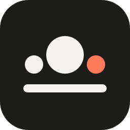

<p align="center">
  <picture>
    <source media="(prefers-color-scheme: dark)" srcset="assets/brand/mark-inverse.svg">
    
  </picture>
</p>

<h1 align="center">Yunidesk</h1>

<p align="center">An open-source, self-hosted support desk in the style of Intercom and Crisp.<br>One Cloudflare Worker, your own account, your data (EU-pinned if you want).</p>

---

- **Team inbox**: real-time conversations, assignment, snooze, internal notes, saved replies, search, contact details, GDPR export and erasure, team invites, settings.
- **Web messenger**: one script tag or `<Yunidesk />` from `yunidesk-react`. Cross-origin iframe, attachments, typing, read receipts, ratings, unread badge. English and French.
- **React Native SDK**: a native messenger for Expo and React Native apps with the same behaviour, photos, camera and files.
- **Identity verification**: your backend signs a short-lived token for the signed-in user; without it a caller is only an anonymous visitor.
- **API keys and webhook endpoints** for integrations: scoped keys that act as bot teammates, signed webhooks with retries and a delivery log, an OpenAPI 3.1 description and a typed client (`yunidesk/api`). See [docs/INTEGRATIONS.md](docs/INTEGRATIONS.md).
- Retention jobs, rate limits, strict CSP.

Runs on Cloudflare Workers, D1, R2 and Durable Objects (hibernatable websockets). No servers to keep alive, no third-party data processor besides Cloudflare (and Resend, if you turn on email).

## Packages

| npm | What it is |
|---|---|
| [`yunidesk`](packages/protocol) | Shared types, the contact client (REST + realtime), `yunidesk/identity` (sign identity tokens on your server), `yunidesk/webhooks` (verify webhook signatures), `yunidesk/api` (team API client for API keys) |
| [`yunidesk-react`](packages/react) | `<Yunidesk />` and `useYunidesk()` for React and Next.js sites |
| [`yunidesk-react-native`](packages/react-native) | `SupportProvider`, `SupportMessenger`, `useSupport()` for Expo and React Native |

The server, dashboard and widget are not on npm: you deploy them from this repository to your Cloudflare account.

## Run it locally

```bash
pnpm install
cp apps/server/.dev.vars.example apps/server/.dev.vars
pnpm --dir apps/server db:migrate:local
pnpm dev     # dashboard http://localhost:5173 · widget dev http://localhost:5174 · worker http://localhost:8787
```

Open http://localhost:5173/setup and use the `SETUP_TOKEN` from `.dev.vars` to create the first owner.

## Deploy

See [docs/DEPLOY.md](docs/DEPLOY.md): create a D1 database and an R2 bucket, set three secrets, `pnpm run deploy`, open `/setup`.

## Add it to your app

```ts
// your server: one authenticated route
import { signUserToken } from "yunidesk/identity";
const token = await signUserToken({ userId: user.id, email: user.email, name: user.name }, process.env.YUNIDESK_IDENTITY_SECRET!);
```

```tsx
// web
import { Yunidesk, useYunidesk } from "yunidesk-react";
<Yunidesk baseUrl="https://support.example.com" getUserToken={fetchSupportToken} userId={user?.id} />;
```

```tsx
// React Native
import { SupportProvider, SupportMessenger } from "yunidesk-react-native";
<SupportProvider baseUrl="https://support.example.com" getUserToken={fetchSupportToken} userId={user?.id}>
  <App />
</SupportProvider>;
```

## Docs

- [Architecture, API and security model](docs/ARCHITECTURE.md)
- [Integrations: API keys and webhooks](docs/INTEGRATIONS.md)
- [Deploying](docs/DEPLOY.md)

## License

[MIT](LICENSE)
